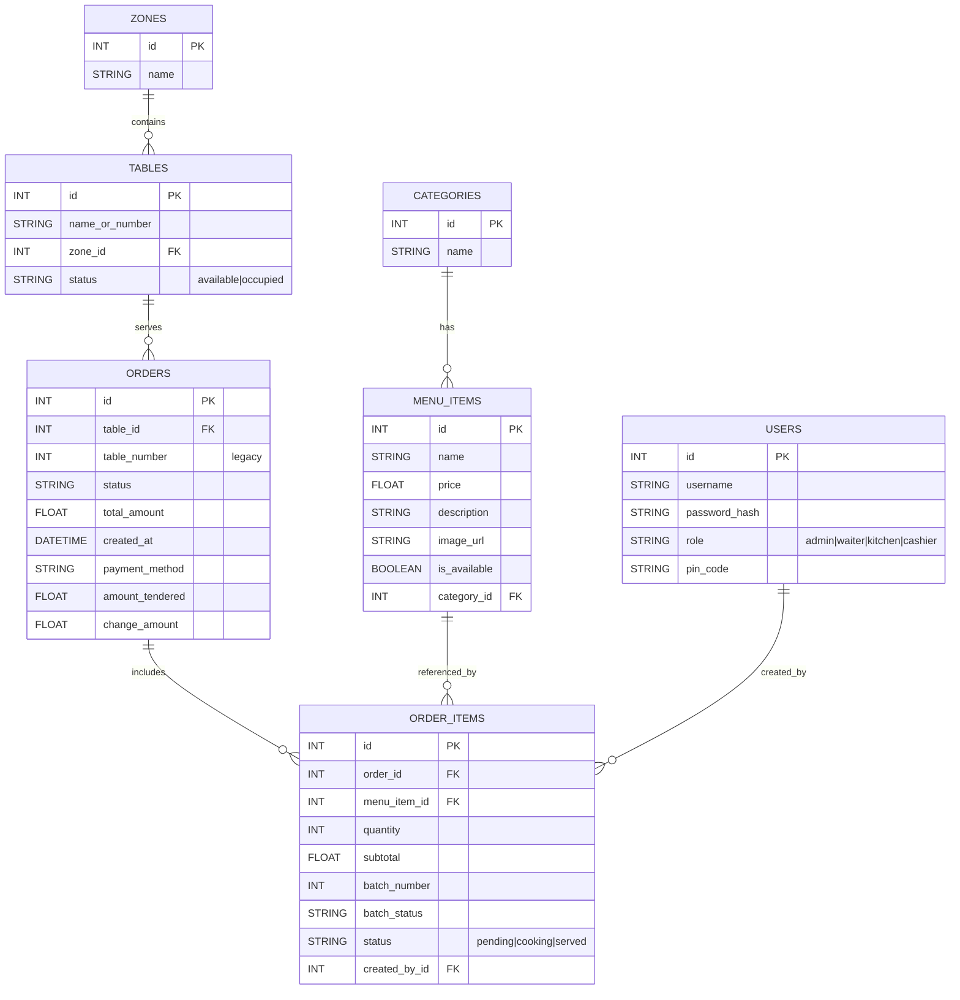

# Database Design (Visual ERD)

This diagram reflects the current SQLAlchemy models in `models.py`.

## Notes

- `Order.table_id` is the normalized table reference.
- `Order.table_number` is kept for backward compatibility with older data.
- `OrderItem.item_status` is stored in DB column `status`.
- Menu availability is controlled by `MenuItem.is_available`.
- Menu deletion is protected when order history exists (safe-delete rule).
