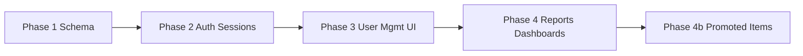

# Plan: RBAC & Authorization Implementation

This plan follows SDD contract-first delivery in **four phases**. Update `schemas.py` before handlers; add tests before marking `validation.md` complete.

> **As-built reference:** `implementation.md` records what is already in the codebase (2026-07-04). Use this plan as the target contract; reconcile gaps via `validation.md`.

> **Stack:** FastAPI backend, static JS frontend (`static/`), SQLite + SQLAlchemy. Not Next.js.

---

## Phase 1 — Database Schema Updates (Roles, Sessions, Audit Logs)

**Goal:** Persist roles, session tokens, audit trail, and checkout attribution without breaking historical orders.

### 1.1 Role model
| Task | Detail |
|------|--------|
| Extend `User.role` enum | `root`, `admin`, `account`, `cashier`, `waiter` |
| Remove `kitchen` from login allowlists | Keep DB rows inert until manual reassignment |
| Add `rbac.py` | Role constants, `SINGLE_DEVICE_ROLES`, `MULTI_DEVICE_ROLES`, permission sets |

### 1.2 New tables / columns
| Entity | Fields | Notes |
|--------|--------|-------|
| `UserSession` | `id`, `user_id`, `jti` (unique), `device_id`, `created_at`, `revoked_at` | One row per active login |
| `AdminAuditLog` | `id`, `actor_user_id`, `action`, `target_user_id`, `detail_json`, `created_at` | Root-readable |
| `Order` | `checked_out_by_id` FK → `User`, `ON DELETE SET NULL` | Cashier attribution |
| `OrderItem` | `created_by_id` (existing) | Waiter/cashier order attribution — verify `ON DELETE SET NULL` |

### 1.3 Promoted items (schema stub — Phase 4b)
| Entity | Fields | Notes |
|--------|--------|-------|
| `MenuItem` | `is_promoted` boolean default `false` | **Defer migration** until Phase 4b; document in schemas only |

### 1.4 Startup migration (`main.py` lifespan)
- `CREATE TABLE` for `user_sessions`, `admin_audit_logs` if missing.
- `ALTER TABLE orders ADD checked_out_by_id` if missing.
- Promote legacy `admin` → `root` when no root exists.
- Remove default admin seed on fresh installs.

### 1.5 Pydantic contracts (`schemas.py`)
- `StaffRole` literal union (five roles).
- `SetupRootRequest`, `ChangePasswordRequest`, `LoginRequest.device_id`.
- `AdminAuditLogResponse`, `UserSessionResponse` (if exposed).
- `StaffSalesPointResponse` for per-staff report rows.

**Phase 1 exit:** Models + schemas compile; DB boots on empty and legacy DB; no auth behavior change yet.

---

## Phase 2 — Auth Logic, Middleware & Device Session Limits

**Goal:** JWT tied to revocable sessions; single-device enforcement; role dependency injection on all protected routes.

### 2.1 JWT & session service
| File | Work |
|------|------|
| `auth.py` | Embed `jti` in JWT; `get_current_user` validates active `UserSession` |
| `services/sessions.py` | `create_session`, `revoke_user_sessions`, `revoke_session` |
| `routers/auth.py` | Accept `device_id` on login + login-pin; issue session row |

### 2.2 Device policy
```
on login(user):
  if user.role in SINGLE_DEVICE_ROLES:
    revoke all active sessions for user
  create new UserSession(jti, device_id)
  return JWT(sub, role, jti)
```

### 2.3 Role middleware
| Helper | Usage |
|--------|-------|
| `require_roles([...])` | FastAPI `Depends` on routers |
| `rbac.py` sets | `ADMIN_PANEL_ROLES`, `POS_ORDER_ROLES`, `CHECKOUT_ROLES`, `FULL_REPORT_ROLES` |

### 2.4 Setup & password endpoints
| Endpoint | Access |
|----------|--------|
| `GET /api/setup/status` | Public |
| `POST /api/setup/root` | Public only when no root |
| `POST /api/auth/change-password` | `root`, `admin`, `account` |

### 2.5 Client device id
| File | Work |
|------|------|
| `static/device.js` | Generate/store UUID `device_id` |
| `static/login.js`, `pin-login.js` | Send `device_id` in login body |

### 2.6 Route guard sweep
Update `require_roles` on: `orders`, `menu`, `tables`, `kitchen_printers`, `reports`, `users`.

**Phase 2 exit:** Login/logout session behavior tested; revoked token returns `401`; role literals enforced on sample endpoints.

---

## Phase 3 — User Management APIs & UI (Hierarchy CRUD)

**Goal:** Root manages admins; admin manages floor staff; all mutations audited.

### 3.1 Root admin API (`routers/root_users.py`)
| Method | Path |
|--------|------|
| `GET` | `/api/root/admins` |
| `POST` | `/api/root/admins` |
| `PUT` | `/api/root/admins/{id}` |
| `DELETE` | `/api/root/admins/{id}` |
| `POST` | `/api/root/admins/{id}/reset-password` |
| `GET` | `/api/root/audit-logs` |

### 3.2 Admin staff API (`routers/users.py`)
- Restrict create/update role to `ADMIN_MANAGEABLE_ROLES`.
- Reject `admin`/`root` targets with `403`.
- Write `AdminAuditLog` on create/update/delete via `services/audit.py`.

### 3.3 Frontend — governance UI
| Surface | Role | Features |
|---------|------|----------|
| `/setup` | public | One-time root creation |
| Counter → **Admin Accounts** tab | `root` | Admin CRUD + reset password |
| Counter → **Staff Management** tab | `admin`, `root` | Cashier/waiter/account CRUD |
| Nav → **Change Password** | `root`, `admin`, `account` | Modal in `auth.js` |
| Counter → **Audit Logs** tab | `root` | List/filter audit entries |

### 3.4 Frontend — access routing
| Role | Default landing |
|------|-----------------|
| `root`, `admin` | `/counter` |
| `account` | `/account` |
| `cashier` | `/counter` |
| `waiter` | `/waiter` |

**Phase 3 exit:** Hierarchy CRUD works end-to-end; admin cannot escalate; audit rows written; root can list logs via API + UI.

---

## Phase 4 — Dashboards & Reporting (Sales Tracking, Promoted Items vs Waiter)

**Goal:** Role-scoped dashboards calling backend report APIs; waiter incentive foundation.

### 4.1 Checkout attribution (`routers/orders.py`)
- On successful checkout, set `Order.checked_out_by_id = current_user.id`.
- Restrict checkout to `CHECKOUT_ROLES`.

### 4.2 Report access layer (`services/report_access.py`)
- `assert_report_date_range` — 93-day cap for `account`.
- `can_view_staff_breakdown`, `can_view_all_waiter_sales` helpers.

### 4.3 Report endpoints (`routers/reports.py`)
| Endpoint | Scoping |
|----------|---------|
| `GET /api/reports/summary/today` | Role-filtered totals |
| `GET /api/reports/daily-sales` | Store trend; account cap |
| `GET /api/reports/monthly-sales` | Store trend; account cap |
| `GET /api/reports/sales/by-cashier` | root/admin/account: all; cashier: self |
| `GET /api/reports/sales/by-order-staff` | root/admin/cashier: all; waiter: self |

### 4.4 Dashboard UI by role
| Role | Widgets / pages |
|------|-----------------|
| **root** | Today total; Staff Performance date-range cashier/waiter charts (Today / This Month presets); Sales History daily/monthly store charts; audit logs |
| **admin** | Today total; Staff Performance date-range cashier + waiter charts; Sales History |
| **account** | `/account` read-only daily + monthly charts; date-range picker (≤ 93 days) |
| **cashier** | Today own checkout total; Staff Performance waiter chart (date range); no store monthly widget |
| **waiter** | Today own order-line total (minimal or none) |

### 4.5 Cashier ↔ waiter navigation
- Counter nav link **"Take Orders"** → `/waiter` for `cashier` role.
- `waiter.js` allows `cashier` in `POS_ORDER_ROLES`.

### 4.6 Phase 4b — Promoted items (follow-on)
| Step | Detail |
|------|--------|
| Schema | `MenuItem.is_promoted` + admin toggle in menu UI |
| Report | `GET /api/reports/sales/promoted-by-waiter?start=&end=` |
| Scope | Daily/monthly qty + revenue per waiter for promoted lines only |
| Tests | Invariant: promoted totals ⊆ waiter totals |

**Phase 4 exit:** Each role sees only permitted dashboard data; report APIs return `403` for forbidden roles; attribution fields populated on new orders/checkouts.

---

## Cross-Cutting: Tests & Documentation

| Deliverable | Location |
|-------------|----------|
| RBAC test suite | `tests/test_rbac.py` |
| Hierarchy compliance | `tests/test_rbac_hierarchy.py` |
| Root CLI bootstrap | `scripts/seed_root.py` |
| Order role regression | `tests/test_orders_rbac.py` |
| Conftest seeds | `root`, `admin`, `account`, `cashier`, `waiter` |
| Validation checklist | `specs/feature-rbac/validation.md` |
| Changelog entry | `CHANGELOG.md` |

**Merge gate:** `pytest -q` green + validation manual sign-off + security checklist.

---

## Suggested Implementation Order (summary)



| Phase | Primary outputs |
|-------|-----------------|
| 1 | `UserSession`, `AdminAuditLog`, `checked_out_by_id`, `rbac.py`, schemas |
| 2 | Session-aware JWT, single-device revoke, `device_id`, route guards |
| 3 | `/api/root/*`, audited `/api/admin/users`, setup + staff UI |
| 4 | Role-scoped reports + per-role dashboard widgets |
| 4b | `is_promoted` + incentive reports (deferred) |

---

## Current Gap Snapshot (vs this plan)

| Item | Status |
|------|--------|
| Phases 1–2 backend | Implemented |
| Phase 3 API + UI | Implemented; audit log **viewer UI** complete (2026-07-04) |
| Phase 4 APIs | Implemented |
| Phase 4 dashboard widgets | **Done** (2026-07-04) — account history, staff charts, Take Orders nav |
| Phase 4b promoted items | **Done** (2026-07-04) |
| Open decisions (§12) | **Resolved** 2026-07-04 — root superset, cashier daily-only, audit PIN redaction |
| Automated tests | **72 passed** (2026-07-05) |
| Role creation hierarchy | **Verified** — `tests/test_rbac_hierarchy.py` (5 scenarios) |
| First root bootstrap | **CLI** — `scripts/seed_root.py` (production); `/api/setup/root` dev/test only |
